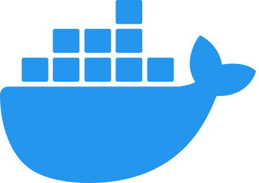

.. raw:: html

   

Installation
=================
``f1tenth_gym`` supports Python 3.11–3.15.
Use a fresh virtual environment rather than upgrading an old Python 3.8 environment.
The existing four-value reset/step API is preserved. Rendering requires system
OpenGL/GLU libraries and a working display.
We provide two ways to set up the environment.

Using docker
----------------

A Dockerfile is provided. A container can be created by running the following commands. Note that ``sudo`` might be needed depending on how you've set up your Docker engine.

.. code:: bash

    $ git clone https://github.com/f1tenth/f1tenth_gym.git
    $ cd f1tenth_gym

    $ docker build -t f1tenth_gym -f Dockerfile .
    $ docker run -it --name=f1tenth_gym_container --rm f1tenth_gym

Using pip
---------------

The environment is a Python package, and only depends on ``numpy``, ``scipy``, ``numba``, ``Pillow``, ``gym``, ``pyyaml``, and ``pyglet``. You can install the package via pip:

.. code:: bash

    $ python3.15 -m venv .venv
    $ source .venv/bin/activate
    $ python -m pip install --upgrade pip
    $ python -m pip install -e .

Run these commands from the repository checkout. Gym and pyglet are kept on
legacy API versions to preserve existing callers and the OpenGL renderer;
Gymnasium/pyglet 2 migration is intentionally outside this compatibility update.
